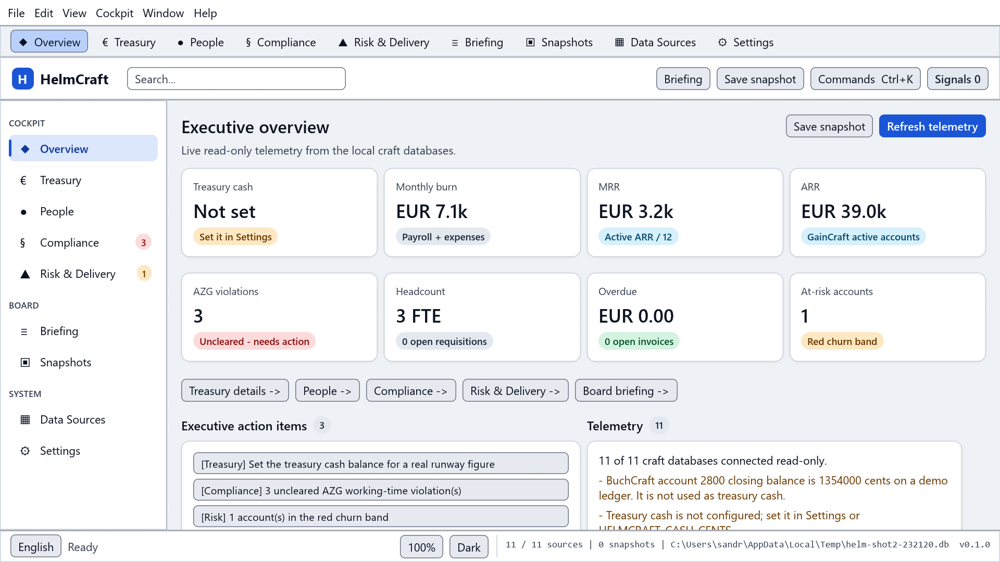
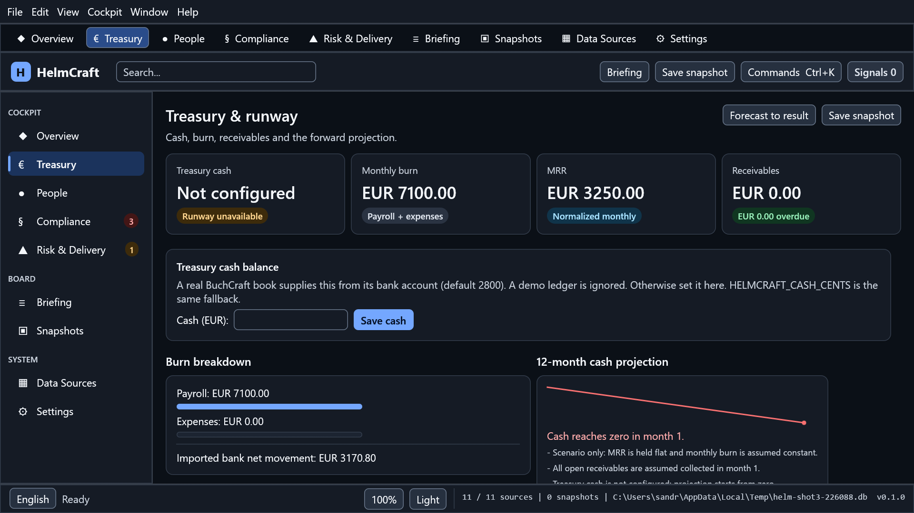

# HelmCraft


**Local-first sovereign CEO & CFO Executive Cockpit, Fleet Telemetry Radar, and Board Briefing Engine.**

Reads the sibling craft databases directly (read-only) and turns them into a
navigable executive cockpit: treasury and runway, people and AZG compliance,
delivery risk, board briefing and snapshot history.

## Preview





## Features

- **Nine navigable pages**: Overview, Treasury, People, Compliance, Risk &
  Delivery, Briefing, Snapshot history, Data Sources, Settings. Switch from the
  navigation rail, the View menu, or Alt+1..9.
- **Craft Menu Bar Standard shell**: File, Edit, View, Cockpit, Window, Help;
  command palette (Ctrl+K) over every tool with generated forms; dark/light
  theme and Ctrl+wheel zoom persisted per user.
- **Readable by default**: Segoe UI type scale (14.5 pt body, 21 pt headings),
  high-contrast light and dark palettes, no grey-on-white text.
- **Click-through**: KPI cards and executive action rows open the page that owns
  the metric; tables are sortable and filterable.
- **Live multi-database telemetry** (read-only SQLite):
  - `billcraft.db`: receivables, overdue invoices, subscriptions.
  - `spendcraft.db`: reimbursed expenses feeding monthly burn.
  - `teamcraft.db`: active FTE, payroll, uncleared AZG violations.
  - `hirecraft.db`: open requisitions, candidate pipeline, pending offers.
  - `gaincraft.db`: active ARR, churn bands, renewals.
  - `taskcraft.db`: active and blocked issues.
  - `assetcraft.db`: unassigned hardware.
  - `contractcraft.db`: contracts renewing within 90 days.
  - `deskcraft.db`: open tickets and first-response SLA breaches.
  - `buchcraft.db`: bank-account closing balance (treasury cash source).
  - `formcraft.db`: NPS responses.
- **Honest provenance**: a missing or empty source reads zero and is listed on
  the Data Sources page and in `data_notes`; no invented fallbacks. Treasury cash
  is BuchCraft's bank-account closing balance when that ledger is real, otherwise
  the app setting or `HELMCRAFT_CASH_CENTS`, and the window says "not configured"
  until one exists.
- **Board briefing and snapshots**: generated summary, risk radar and
  recommendations; Markdown export; snapshot save/list/delete with current-value
  comparison; snapshot CSV export.
- **Tri-modal interface**:
  - **L1 CLI**: `helmcraft status`, `briefing`, `forecast`, `sources`, `set-cash`,
    `save-snapshot`, `snapshots`, `export-briefing`, `export-snapshots`.
  - **L2 MCP**: 11 stdio tools, including snapshots, exports, cash and source audit.
  - **L3 GUI**: native `egui 0.37` cockpit via `helmcraft-app`.

## Architecture

- `crates/helmcraft-store`: read-only multi-database query aggregator, provenance,
  settings and historical snapshot persistence.
- `crates/helmcraft-core`: executive briefing synthesizer, cashflow forecaster,
  board report renderer.
- `crates/helmcraft-mcp`: stdio JSON-RPC MCP server and CLI binary (`helmcraft`).
- `crates/helmcraft-app`: native desktop cockpit (`helmcraft-app`) on `craft-biz-ui`.

## Quick Start

```powershell
# Run smoke tests (window smoke + CLI status)
.\start.ps1 -Smoke

# Launch native desktop app
.\start.ps1

# Run MCP server on stdio
.\start.ps1 -Mcp
```

## License

MIT OR Apache-2.0
